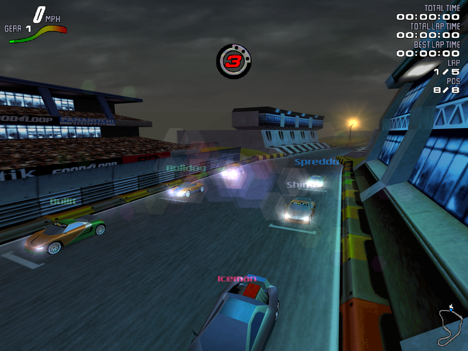

# motorhead_rust

This is **Motorhead**, the racing game from 1998 by Digital Illusions CE and Gremlin, running
as a native program on today's Windows and Linux.

> **Work in progress.** This port still has problems. I'm working on it.

It works like this. When you start it for the first time, it takes the `motor.exe` from your
own copy of the game and translates it into machine code for your computer. Everything the old
game expected from Windows 98 and its 3dfx graphics card is rebuilt in Rust. The game itself
is not part of this project. You need your own CD.


<table>
  <tr>
    <td width="33%"></td>
    <td width="33%"></td>
    <td width="33%"></td>
  </tr>
  <tr>
    <td align="center"><em>The start at night</em></td>
    <td align="center"><em>Under the bridge</em></td>
    <td align="center"><em>The main menu</em></td>
  </tr>
</table>

## How to play

1. Download the latest version from the [releases] page and unpack it. There is a zip file for
   Windows and a tar.gz file for Linux.
2. Make an image of your Motorhead CD (a .bin file with its .cue file) and put both files next
   to `motorhead.exe`, or into the `game_files` folder.
3. Start `motorhead.exe`. On Linux, run `./motorhead` in its folder.

The first start takes a moment. The game is installed from your CD image into
`game_files/Motorhead`, the videos go to `game_files/Movies`, and the game is translated once.
After that it starts quickly.

Please leave the CD image where it is. The music in the game comes from the audio tracks on
the CD, so it is played from the image.

It works with the European PC version of the game. If you have a different version, the program
tells you so. If something goes wrong, look into `motorhead.log` next to the program.

On Linux you need the usual libraries for sound and gamepads. Every desktop distribution has
them installed already.

## What is better than the original

- **Sharp picture:** The game is drawn at the full size of your window or screen, not at
  640x480. Alt+Enter switches to fullscreen.
- **Widescreen:** A race fills a wide screen and shows more of the track to the sides. The
  HUD stays in the middle.
- **Smooth:** The game shows as many pictures as your monitor can display (up to 240 per
  second). The race itself still runs at the same speed as on the original.
- **Gamepad like a modern racing game:** Analog steering and analog gas and brake on the
  triggers, whatever control layout is chosen in the game. See below.
- **Settings menu (F10):** All new options in one place, see below.
- **Fixed glitches:** The light halos and lens flares no longer flicker, and the game no longer
  crashes at the finish line.
- **No CD drive needed:** Videos and music come from your CD image.
- **Frame rate display:** F12 shows it.

## Gamepad

Plug in an Xbox-style gamepad (before or after the start). It works in every control layout
of the game, next to the keyboard.

| Button | In a race | In the menus |
|---|---|---|
| Left stick | Steer (gently near the middle, full at the edge) | Move |
| D-pad left/right | Steer (full) | Move |
| RT / LT | Gas / brake, as far as you pull them | |
| RB / LB | Gear up / down (manual gearbox) | |
| A | Handbrake | Confirm |
| B | Horn | Back |
| Y | Rear view | |
| X | Change the camera | |
| Start | Game menu | |

## The settings menu (F10)

Press **F10** at any time, in the menus or in a race. The game pauses while the menu is open.
Every change works at once and is saved for the next start.

How to use it: Up and Down choose a line, Left and Right change it. Page Up and Page Down (or
Tab) switch between the pages. Escape or F10 closes the menu. The mouse works too.

**Display**

| Setting | What it does |
|---|---|
| Fullscreen | The game fills the whole screen without a border. Alt+Enter does the same. |
| Resolution | The size of the window and of the picture. "Auto" uses the window's size. |
| Anti-aliasing | Smooth edges instead of jagged ones. |
| Textures | Sharper textures from a distance: Original, Trilinear or Anisotropic. |
| Frame rate display | Shows how many pictures per second you get. F12 does the same. |
| Widescreen | Races as wide as the window, the HUD in the middle. On by default. |
| Vsync | The picture changes only when the screen refreshes, so it never tears. On by default. |
| Frame limit | The most pictures per second in a race. "Display" matches your screen's refresh rate (up to 240). |

**Advanced**

Improvements that go beyond the look of the original.

| Setting | What it does |
|---|---|
| Soft lights | Light halos and lens flares no longer add up to a white blot where many of them overlap (as at the start on RedRock). On by default. |
| Distance sharpness | Keeps the road and walls sharp further ahead of the car: Original, Sharper, Much sharper or Sharpest. The sharper settings shimmer a little in the distance. Works with trilinear and anisotropic filtering. Original by default. |

## What does not work yet

Network play is still missing. The Linux version is built automatically but
nobody has played it yet. The game has also not been played all the way through, so please
tell us if you find a problem.

## Building it yourself

```
cargo build --release
cargo run --release -- path/to/motor.exe
```

Without a path, the program looks for the game in `game_files`, just like the release does.
`cargo test --release` runs the tests and needs no game files. Notes on how everything works
are in `CLAUDE.md` and `PLAN.md`.

## License

The code in this project is under the MIT license. The game and its files belong to their
owners and are not part of this project.

Built with [recomp_kit].

[recomp_kit]: https://github.com/RadiatorTwo/recomp_kit
[releases]: https://github.com/RadiatorTwo/motorhead_rust/releases
