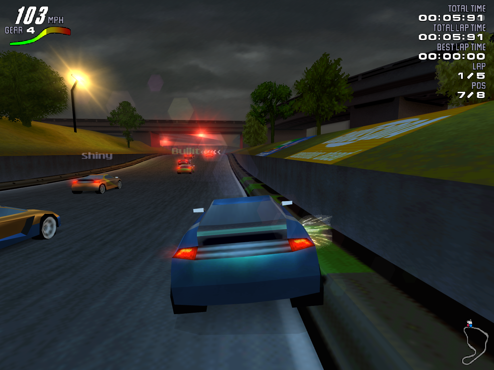
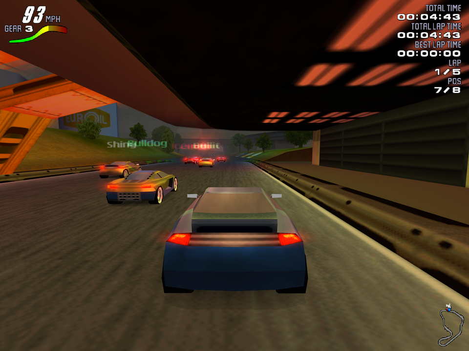
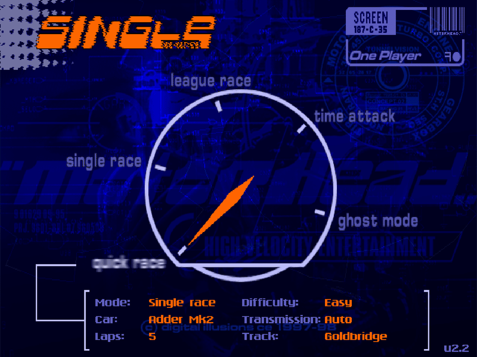

# motorhead_rust

This is **Motorhead**, the racing game from 1998 by Digital Illusions CE and Gremlin, running
as a native program on today's Windows and Linux.

It works like this. When you start it for the first time, it takes the `motor.exe` from your
own copy of the game and translates it into machine code for your computer. Everything the old
game expected from Windows 98 and its 3dfx graphics card is rebuilt in Rust. The game itself
is not part of this project. You need your own CD.



<table>
  <tr>
    <td width="33%"></td>
    <td width="33%"></td>
    <td width="33%"></td>
  </tr>
  <tr>
    <td align="center"><em>The start at night</em></td>
    <td align="center"><em>Under the bridge</em></td>
    <td align="center"><em>The main menu</em></td>
  </tr>
</table>

## How to play

1. Download the latest version from the [releases] page and unpack it. There is a zip file for
   Windows and a tar.gz file for Linux.
2. Make an image of your Motorhead CD (a .bin file with its .cue file) and put both files next
   to `motorhead.exe`, or into the `game_files` folder.
3. Start `motorhead.exe`. On Linux, run `./motorhead` in its folder.

The first start takes a moment. The game is installed from your CD image into
`game_files/Motorhead`, the videos go to `game_files/Movies`, and the game is translated once.
After that it starts quickly.

Please leave the CD image where it is. The music in the game comes from the audio tracks on
the CD, so it is played from the image.

It works with the European PC version of the game. If you have a different version, the program
tells you so. If something goes wrong, look into `motorhead.log` next to the program.

On Linux you need the usual libraries for sound and gamepads. Every desktop distribution has
them installed already.

## What is better than the original

- The game is drawn at the full size of your window or screen, not at 640x480.
- Alt+Enter switches to fullscreen.
- Press F10 for the settings: resolution, anti-aliasing, texture filtering and more.
- The game runs smoothly at the frame rate of your monitor (up to 240 frames per second).
  The race itself still runs at the same speed as on the original. F12 shows the frame rate.
- The light halos and lens flares no longer flicker.
- Videos and music work without a CD drive.

## What does not work yet

Widescreen, gamepads and network play are still missing. The Linux version is built
automatically but nobody has played it yet. The game has also not been played all the way
through, so please tell us if you find a problem.

## Building it yourself

```
cargo build --release
cargo run --release -- path/to/motor.exe
```

Without a path, the program looks for the game in `game_files`, just like the release does.
`cargo test --release` runs the tests and needs no game files. Notes on how everything works
are in `CLAUDE.md` and `PLAN.md`.

## License

The code in this project is under the MIT license. The game and its files belong to their
owners and are not part of this project.

Built with [recomp_kit].

[recomp_kit]: https://github.com/RadiatorTwo/recomp_kit
[releases]: https://github.com/RadiatorTwo/motorhead_rust/releases
